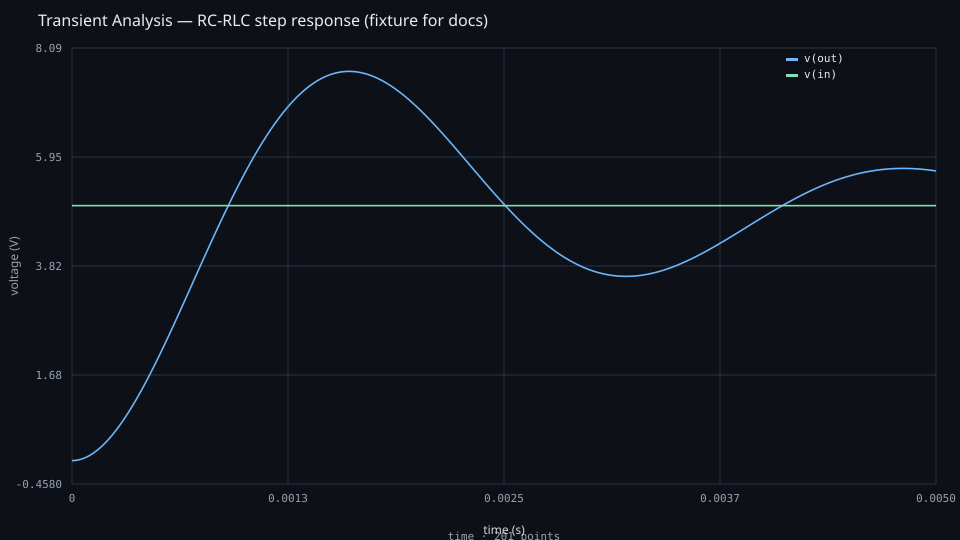

# spice-raw

Read SPICE waveform files — the `.raw` files LTspice and ngspice write next to a netlist.

Every simulator can produce waveforms; almost none can show them well. The file format is the part
they share, so a reader that understands both dialects is useful on its own, and it is the
foundation for a viewer that does not care who produced the data.

## What it handles

- the ASCII header (`Title`, `Date`, `Plotname`, `Flags`, `No. Variables`, `No. Points`, the variable
  table), LF and CRLF;
- binary payloads of 8-byte doubles and 4-byte floats;
- complex plots (ngspice AC): the real part as the column, the imaginary part kept beside it;
- the `fastaccess` layout, where data is stored variable-major instead of point-major;
- ASCII (`Values:`) plots.



Переходный процесс недодемпфированного RLC-звена (ζ = 0.2, ωn = 2000 рад/с), прочитанный из
ASCII `.raw` и нарисованный самим `rawread` — картинка в README это результат команды, а не
скриншот из LTspice:

```bash
rawread examples/fixtures/step-rlc.raw --svg docs/waveform.svg --column time
```

## Use

```console
$ rawread plot.raw
title:     differential pair
plot:      Transient Analysis
points:    3
variables: 2
  time                     time       0  1e-6  2e-6
  V(out)                   voltage    0  1.5   3

$ rawread plot.raw --column V(out)      # one column, for a spreadsheet
$ rawread plot.raw --csv                # everything, as CSV
```

```rust
let plot = spice_raw::parse(&std::fs::read("plot.raw")?)?;
let time = plot.column_at(0).unwrap();
let vout = plot.column("V(out)").unwrap();
```

## Tests

Thirteen tests, no fixtures on disk: the files are built byte by byte in the tests, so the parser
is checked against the format rather than against one saved sample — point-major doubles,
variable-major `fastaccess`, complex pairs, truncation, a header with no data section,
case-sensitive column names, and two regressions found while writing the README plot:

- **CRLF before the data marker** — the marker was searched as `Values:\n`, so a file written by
  LTspice (which uses CRLF) was refused with "the header has no Binary: or Values: section".
- **ASCII payload split on a blank line** — LTspice and ngspice write one running token stream with
  no blank lines between points, so every point after the first stayed zero and only the first
  column of the first point was right. The reader now walks the stream and starts a new point at a
  line that carries the point index, bounded by `No. Points × No. Variables` so a damaged file
  cannot make it spin.

## Why a caller might want this

- a fast waveform viewer that is not from 2003;
- a CI check that a simulation actually produced the waveform it claims;
- converting `.raw` into CSV/Parquet for analysis;
- comparing two simulators on the same netlist.

## Licence

MIT.
